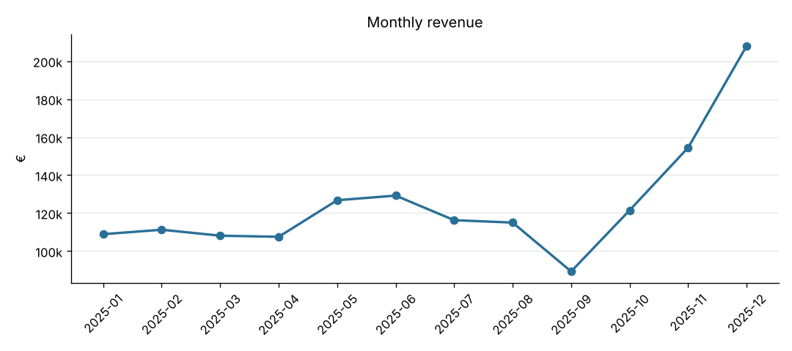
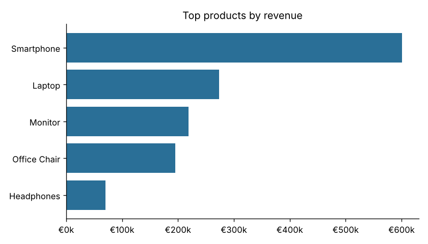
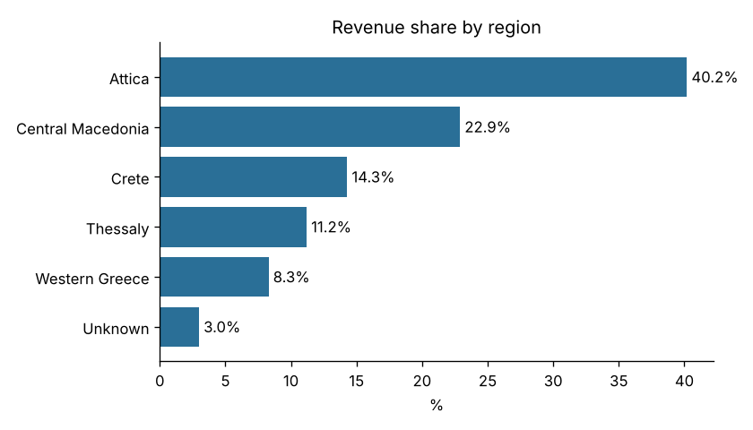

# Sales report

## Data cleaning
- **rows in**: 5,100
- **duplicates removed**: 100
- **prices imputed**: 125
- **invalid rows dropped**: 50
- **rows out**: 4,950

## KPIs
- Total revenue: **€1,496,425.41**
- Orders: **4,950** · Customers: **1,178** · Units: **8,820**
- Average order value: **€302.31**
- Repeat-customer rate: **93.3%**
- Best month: **2025-12** (€208,009)

## Monthly revenue
| month   |   revenue |   orders | mom_growth_pct   |
|:--------|----------:|---------:|:-----------------|
| 2025-01 | 108,921.0 |      390 | —                |
| 2025-02 | 111,251.8 |      417 | +2.1%            |
| 2025-03 | 108,130.7 |      424 | -2.8%            |
| 2025-04 | 107,530.9 |      416 | -0.6%            |
| 2025-05 | 126,792.1 |      407 | +17.9%           |
| 2025-06 | 129,222.0 |      432 | +1.9%            |
| 2025-07 | 116,281.8 |      424 | -10.0%           |
| 2025-08 | 115,021.6 |      393 | -1.1%            |
| 2025-09 |  89,299.2 |      383 | -22.4%           |
| 2025-10 | 121,513.8 |      430 | +36.1%           |
| 2025-11 | 154,451.6 |      379 | +27.1%           |
| 2025-12 | 208,008.9 |      455 | +34.7%           |

## Top 5 products
| product      |   revenue |   units |
|:-------------|----------:|--------:|
| Smartphone   |   600,838 |    1146 |
| Laptop       |   273,899 |     325 |
| Monitor      |   218,835 |    1044 |
| Office Chair |   194,997 |    1084 |
| Headphones   |    70,575 |     896 |

## Revenue by channel
| channel     |   revenue |   share_pct |
|:------------|----------:|------------:|
| web         | 729,959.3 |        48.8 |
| mobile      | 536,519.5 |        35.9 |
| marketplace | 229,946.6 |        15.4 |

## Category × region (€)
| region            |   Accessories |   Electronics |    Home |   Stationery |
|:------------------|--------------:|--------------:|--------:|-------------:|
| Attica            |        25,216 |       464,503 | 107,290 |        4,182 |
| Central Macedonia |        14,344 |       272,444 |  54,278 |        2,031 |
| Crete             |         8,951 |       166,074 |  38,245 |        1,337 |
| Thessaly          |         6,779 |       131,815 |  27,948 |          952 |
| Unknown           |         1,804 |        35,282 |   8,175 |          316 |
| Western Greece    |         6,946 |        94,029 |  22,673 |          810 |

